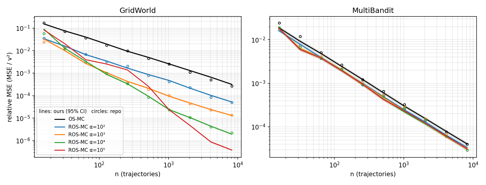
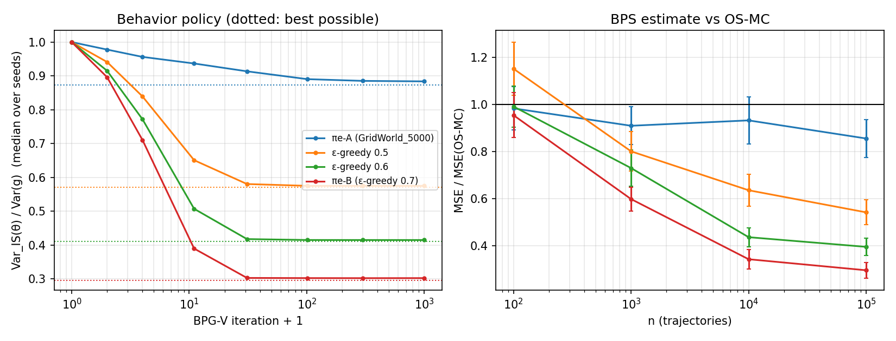

# Phase 1: Reproducing BPS and ROS

We reimplemented behavior policy search (BPS, [1]) and robust on-policy sampling (ROS, [2]) and reproduced their policy-evaluation results. Everything runs on the ROS repository's GridWorld and MultiBandit, with exact ground truth from dynamic programming.

## Results

**ROS reproduces.**
- Our ROS matches the repository's stored runs in both domains at every α it ran (1 to 10⁴), within the confidence intervals.
- On GridWorld at n = 8192 trajectories, ROS with the paper's α = 10³ has 24× lower MSE than on-policy Monte Carlo (OS-MC).
- On MultiBandit the gain is small (1.3×). Reward noise dominates there, and ROS can only remove the variance from which arm gets pulled. Our runs reach that closed-form limit.

**Beyond the paper: larger α keeps helping on GridWorld.**
- α = 10⁴ is 7× better than α = 10³ at n = 8192.
- α = 10⁵ converges at rate n⁻² instead of n⁻¹, at the cost of higher error for n ≤ 512.

**BPS reproduces.**
- BPG-V reaches 99% of the best possible variance reduction for the ε-greedy evaluation policies.
- On πe-B (ε = 0.7) it removes 69.8% of the variance; [1] reports 73.5% for its own GridWorld policy.
- Its adaptive importance-sampling estimate has 0.30× the MSE of OS-MC after 10⁵ trajectories.

**Why BPS looked no better than on-policy sampling in [2].** There are two reasons:
1. [2]'s evaluation policy, πe-A, leaves little to gain: even the optimal behavior policy removes only 12.6% of the variance.
2. [2]'s BPG settings (plain SGD, no baseline, rewards divided by v) make 3% of seeds diverge, and those seeds dominate the mean MSE (2.6× OS-MC).

With [1]'s settings on πe-B, BPS gets 0.35× the MSE of OS-MC at [2]'s budget of 8192 trajectories.


*Relative MSE (MSE/v²) vs number of trajectories. Lines are ours (1000 seeds, shaded 95% CI); circles are the repository's stored runs (200 seeds).*


*Left: exact OIS variance of BPG-V's behavior policy, relative to on-policy Monte Carlo. Dotted lines show the best possible tabular behavior policy. Right: MSE of BPS's estimate relative to OS-MC (mean ± SE, 200 seeds).*

Full tables: [results/ros_reproduction.md](results/ros_reproduction.md) and [results/bps_reproduction.md](results/bps_reproduction.md).

## Run

From the repository root, after the setup in the [top-level README](../README.md):

```bash
python -m phase1_reproduction.tests               # sanity checks, 5 s
python -m phase1_reproduction.ros_reproduction    # 15 s; writes results/ros_reproduction.{md,png}
python -m phase1_reproduction.bps_reproduction    # 30 s; writes results/bps_reproduction.{md,png}
```

All randomness comes from named streams, so reruns give identical numbers.

## Differences from the papers
- **Metric.** [2] reports relative MSE (MSE/v²), because its repository divides rewards by v. We report the same metric to compare.
- **Ground truth.** The repository's ground truth comes from 10⁶ rollouts. Its squared relative error (3·10⁻⁸ on GridWorld) is only about 10× below ROS's smallest MSEs (4·10⁻⁷), so we use exact dynamic programming instead.
- **Bandit.** The repository's MultiBandit is one fixed instance (seed 0), not resampled per run as [2]'s text says. [2]'s Table 3 bandit numbers do not match the repository, so we compare against its stored runs.
- **BPS policies.** [1]'s GridWorld evaluation policies are not public. We use the ROS repository's GridWorld_5000 (πe-A) and its ε-greedy variants (πe-B: ε = 0.7).

## Code

```
core/envs.py       the repository's GridWorld and MultiBandit, its pretrained policies, ε-greedy variants
core/exact.py      exact value, return variance, OIS variance and its gradient; optimal behavior policy
core/sampling.py   OS and ROS data collection with Monte Carlo estimates (numba, parallel over seeds)
core/bpg.py        BPG-V ([1] Alg. 1) and the repository's BPG variant, with the adaptive OIS estimate
core/rng.py        counter-based random numbers: every method sees the same randomness per seed
core/repo_io.py    reads the repository's policies and stored results without PyTorch
core/stats.py      bootstrap confidence intervals, convergence slope
```
