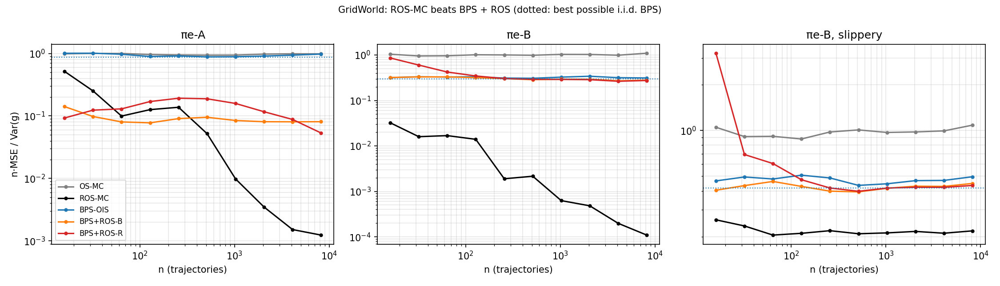
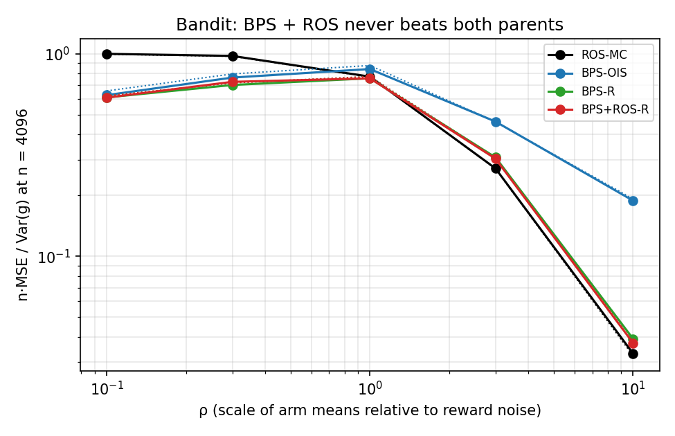

# Phase 2: BPS + ROS does not beat ROS

**The method.**
1. Learn the BPS behavior policy (the *target*) with BPG-V.
2. Collect data by tracking the target with ROS, so that the sample matches it closely.
3. Reweight the data to πe.

If the two ideas composed, the MSE would fall below both BPS alone and ROS alone. Three weightings were tried:
- **A:** the probabilities actions were actually drawn with;
- **B:** the target's probabilities;
- **R:** the data's empirical policy (regression IS).

## Results

**It does not compose.** All MSEs below are on the same seeds (common random numbers), at the largest n.

| Domain | BPS + ROS vs ROS-MC | BPS + ROS vs BPS alone (i.i.d. + OIS) | BPS + ROS vs i.i.d. from the target + R |
|---|---|---|---|
| GridWorld, πe-A | **43× worse** | 0.05× | 1.03 (same) |
| GridWorld, πe-B (ε = 0.7) | **2500× worse** | 0.88× | 1.00 (same) |
| GridWorld, πe-B, slippery | **2.0× worse** | 0.88× | 0.99 (same) |
| Bandit, ρ = 0.1 / 0.3 | 0.61× / 0.74× | 0.97 / 0.95 (same) | 1.00 / 1.04 (same) |
| Bandit, ρ = 1 | 0.98 (same) | 0.90× | 1.00 (same) |
| Bandit, ρ = 3 / 10 | **1.12× / 1.13× worse** | 0.66× / 0.20× | 0.99 / 0.95 (same) |

- The table uses the learned target: BPG-V on 1024 trajectories per seed.
- ρ scales the bandit's arm means relative to its reward noise.

**GridWorld.** ROS-MC wins everywhere. With the *exact* BPS target the gaps are 24×, 2400× and 1.8×, so better target learning would not change the result.

**Bandit.** BPS + ROS beats ROS-MC only where reward noise dominates (ρ ≤ 0.3), and beats BPS alone only where arm means matter (ρ ≥ 1). With the learned target it never beats both. With the exact target it does so once, at ρ = 0.3.

**Tracking itself adds nothing (last column).** BPS + ROS has the same MSE as sampling i.i.d. from the same target and reweighting with R.


*n·MSE/Var(g) against the number of trajectories (on-policy Monte Carlo = 1). Dotted line: the best possible i.i.d. BPS. Tracked BPS stays on it, while ROS-MC falls far below.*


*n·MSE/Var(g) at n = 4096 against ρ. Dotted lines are the closed-form limits.*

Full tables, including A and the exact target: [results/gridworld.md](results/gridworld.md) and [results/bandit.md](results/bandit.md).

## Why it fails

1. **BPS optimizes the wrong objective once ROS is applied (both domains).**
   - BPS's target minimizes the variance of OIS. Most of that variance comes from which actions happen to be sampled, and that is exactly what ROS (or R) removes. What remains is reward and transition noise, which BPS's target was not built for.
   - The bandit makes this exact. After tracking, n·MSE → Σₐ πe(a)² σₐ² / q(a) for target q. BPS's q ∝ πe·√(μ² + σ²) moves samples toward arms with large |μ|, which no longer helps.
   - So when means dominate (ρ ≥ 3), tracking BPS's target is worse than tracking πe itself, which is ROS-MC.
2. **ROS cannot control trajectory weights (GridWorld).**
   - The importance weight of a trajectory is a product over its steps. ROS matches each state's action frequencies, but not the joint distribution of whole trajectories that this product depends on. Tracked BPS therefore keeps the variance of i.i.d. BPS: 0.28 vs 0.30 on πe-B.
   - Tracked BPS converges at the Monte Carlo rate (slope −1.0). ROS-MC needs no weights, and in the deterministic GridWorld it converges at n⁻² (slopes −2.0 and −1.9).
   - Weighting by the actual sampling probabilities (A) does worse still: at the α where it is stable it matches BPS alone, and its weights explode for larger α.

**Scope.** This failure is for estimators that weight whole trajectories (A, B, R). An estimator without product weights changes the picture; that is a later phase.

**Variants tried in earlier experiments, none of which changes the conclusion:**
- Tracking per (cell, time step) instead of per cell: 1.6–1236× worse.
- Variants of R, using the empirical policy per (cell, time step) or add-one smoothing: biased (+8% of |v| at n = 8192) or worse at small n.
- The bandit's best target (Neyman allocation) applied per state: worse than BPS alone on πe-A and πe-B (19× and 11×), and no better in the slippery GridWorld.

## Run

From the repository root:

```bash
python -m phase2_bps_plus_ros.experiments.bandit      # 30 s; writes results/bandit.{md,png}
python -m phase2_bps_plus_ros.experiments.gridworld   # 3.5 min; writes results/gridworld.{md,png}
```

All runs, tuning included, use the same named random streams as our original experiments, so they reproduce those numbers exactly.

## Code

```
core/bps_ros.py            the method: learn the BPS target, track it with ROS, estimate with A, B and R
experiments/bandit.py      the 30-arm bandit, ρ = 0.1 … 10
experiments/gridworld.py   GridWorld: πe-A, πe-B, and πe-B with slip 0.1
```

Environments, exact DP, ROS toward πe and BPG-V are imported from [`phase1_reproduction/core`](../phase1_reproduction/core).
