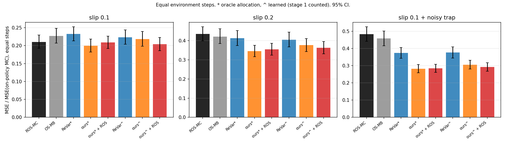

# Phase 3: Model-based estimation with an optimized allocation

Phase 2 found two reasons BPS + ROS fails. Phase 3 removes both:

1. **No trajectory weights.** A model-based (MB) estimator fits transition probabilities and mean rewards from counts, then evaluates πe exactly in the fitted model (tabular certainty equivalence; Yin & Wang 2020).
2. **An objective matched to the estimator.** Pick the behavior policy that minimizes the MB estimator's variance per environment step. To first order, with n episodes from behavior b,

   n·Var(MB) = Σ_{s,a} D_e(s,a)² σ²(s,a) / D_b(s,a),

   where:
   - D_π(s,a) is the expected number of visits to (s, a) per episode under π;
   - σ²(s,a) is the variance of r + V(s′) given (s, a), which includes reward noise and transition noise.

This is the allocation approach of ReVar and SaVeR (Mukherjee, Hanna & Nowak, 2022 and 2024), applied in a different setting:
- **transitions are unknown**, so transition noise enters σ²;
- **the MDP is general**, with cycles and variable-length episodes (ReVar is exact on trees and approximate on layered DAGs);
- **the budget is counted in environment steps**.

## Results

**Setup.**
- Domains: GridWorld with slip 0.1, with slip 0.2, and with slip 0.1 plus Gaussian reward noise (std 11.5) on entering the trap.
- πe = πe-B (ε-greedy 0.7).
- Every method gets the same number of environment steps T: 8192 on-policy episodes' worth.
- Estimator: MB for everything except ROS-MC.
- Learned allocations (^) use T/8 on-policy steps of each seed's budget to fit a model. Those steps are pooled into the estimate.

Paired MSE ratios at T, 1000 seeds, 95% CI (below 1 means the first method is better):

| Comparison | slip 0.1 | slip 0.2 | noisy trap |
|---|---|---|---|
| Ours (learned) vs ROS-MC | 1.04 ~ | **0.87 ✓** | **0.63 ✓** |
| Ours (learned) + ROS vs ROS-MC | 0.97 ~ | **0.84 ✓** | **0.61 ✓** |
| Ours vs ReVar's allocation, both oracle | **0.86 ✓** | **0.84 ✓** | **0.76 ✓** |
| Ours vs ReVar's allocation, both learned | 0.98 ~ | 0.93 ~ | **0.81 ✓** |
| With vs without ROS (ours, learned) | 0.93 ~ | 0.96 ~ | 0.95 ~ |
| On-policy MB vs ROS-MC | 1.08 ~ | 0.97 ~ | 0.95 ~ |


*MSE relative to on-policy Monte Carlo at the same number of environment steps (95% CI). * = oracle allocation, ^ = learned.*

**Takeaways.**
- **Against ROS-MC:** ours wins where noise is large or uneven (1.15× on slip 0.2, 1.6× on the noisy trap) and ties on slip 0.1.
- **Against ReVar's rule:** ours is better when both allocations are computed from the true MDP (1.16–1.32×). When both are learned from data, the difference is detectable only on the noisy trap (1.23×).
- **ROS:** it adds nothing once the estimator is model-based (ratios 0.93–1.04, all within noise).

Full tables, with MSE at T/4, T/2 and T and predicted vs simulated values: [results/gridworld.md](results/gridworld.md).

## Why the gains are modest

- **On-policy MB already matches ROS-MC.** Both remove all action-sampling noise, and what remains is environment noise. Any further gain has to come from allocating samples toward (s, a) pairs where that noise is large.
- **Per step, the gain has a ceiling.** No behavior can beat on-policy MB by more than (Σ D_e σ²)(Σ D_e) / (Σ D_e σ)², which is 1 + CV² of σ under πe's state-action visitation (Cauchy–Schwarz).

  | Domain | Ceiling | Our oracle allocation achieves | ReVar's allocation achieves |
  |---|---|---|---|
  | slip 0.1 | 1.21× | 1.14× | 1.01× |
  | slip 0.2 | 1.22× | 1.15× | 1.01× |
  | noisy trap | 1.87× | 1.55× | 1.23× |

  ReVar's rule counts only reward noise. In the slip domains, most of the noise comes from transitions.
- **Per episode there is no ceiling.** A behavior can buy more transitions by making episodes longer. That is why step budgets are the fair comparison.

**Earlier experiments, not regenerated here:**
- With per-episode budgets, the per-episode-optimal allocation beat ROS-MC by 2.4–4.3×, using about 3× longer episodes.
- In the deterministic GridWorld, MB is exact once every needed (s, a) has been visited. With ROS that happens within 32 episodes, because ROS forces every action to be tried (about 100× better than ROS-MC there).

## Run

From the repository root:

```bash
python -m phase3_mb_allocation.experiments.gridworld   # 2 min; writes results/gridworld.{md,png}
```

## Code

```
core/allocation.py         MB variance formula and its per-step ceiling; our allocation (exact gradient);
                           ReVar's allocation rule; allocations learned from a model fitted to stage-1 data
core/collect.py            data collection under a step budget (i.i.d. or ROS toward a target), MC and MB
                           estimates, with stage-1 data pooled into MB
experiments/gridworld.py   the comparison above
```

Environments, exact DP, ROS and the random-number streams are imported from [`phase1_reproduction/core`](../phase1_reproduction/core).

**References.**
- M. Yin, Y.-X. Wang. *Asymptotically Efficient Off-Policy Evaluation for Tabular RL.* AISTATS 2020.
- S. Mukherjee, J. P. Hanna, R. Nowak. *ReVar: Strengthening Policy Evaluation via Reduced Variance Sampling.* UAI 2022.
- S. Mukherjee, J. P. Hanna, R. Nowak. *SaVeR: Optimal Data Collection Strategy for Safe Policy Evaluation in Tabular MDP.* ICML 2024.
